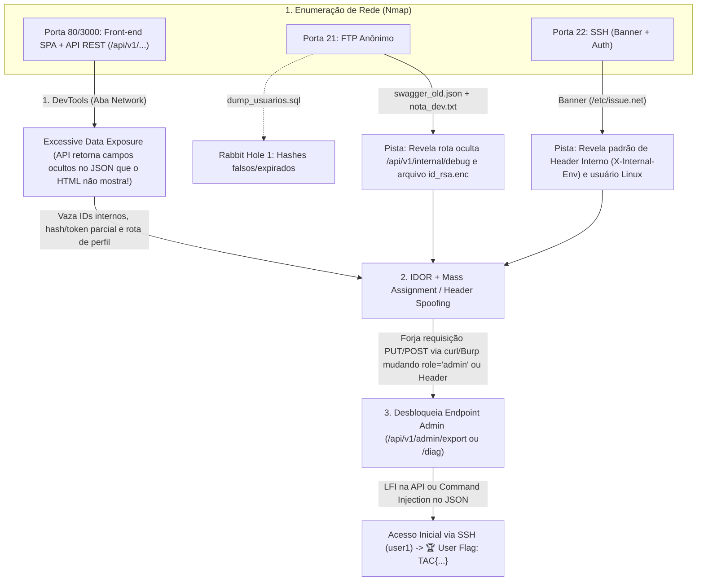

# Planejamento do CTF v2 — Modern Web / API Sec + Multi-Serviço (Grupo de 4 Integrantes)

Este documento atualiza a arquitetura do CTF com foco em **Aplicações Web Modernas (Zero PHP!)**: Front-end desacoplado (React ou HTML/CSS/JS moderno com `fetch()`) consumindo uma **API REST Back-end (Node.js/Express ou Python/FastAPI)**, explorando vulnerabilidades reais de **API Security (OWASP API Top 10)** via **DevTools (Aba Network)**, **Burp Suite / curl / Postman**, combinadas com pistas em **FTP** e **SSH**.

---

## 1. Opções de Temas (Série/Filme vs. Ambientes Sérios/Realistas)

Removemos *Severance* e incluímos **The Rookie**, além de **3 temas sérios/realistas** (incluindo o ambiente universitário inspirado na UnB):

| Categoria | Tema | Contexto Narrativo | Usuários Linux (`user1` / `user2` / `root`) |
| :--- | :--- | :--- | :--- |
| **Série #1** | **The Rookie (LAPD Mid-Wilshire Division)** | O servidor da divisão Mid-Wilshire da LAPD sofreu uma atualização apressada para o novo portal de patrulhas. O jogador analisa os relatórios do John Nolan e Tim Bradford, intercepta chamadas da API de ocorrências policiais e escala privilégios até o terminal do Sargento Grey. | `nolan` / `bradford` / `sgt_grey` |
| **Série #2** | **Brooklyn 99 (Halloween Heist na 99ª Delegacia)** | É o dia do *Halloween Heist*! As flags são as "Coroas" escondidas no servidor da delegacia. Há arquivos de casos do Peralta no FTP, uma SPA da delegacia na Web, dicas do Hitchcock/Scully que são *rabbit holes* e o cofre do Capitão Holt no Root. | `peralta` / `terry` / `capt_holt` |
| **Sério #1 (Universidade)** | **Red Team Universitário — "SIGAA-Next / LabSec UnB" (Fictício)** | Um exercício de Red Team autorizado nos servidores de homologação do novo portal acadêmico unificado da Universidade ("UnB-Next / STI"). O atacante audita a API de notas/matrículas onde os devs deixaram dados vazando no JSON, cruza com backups acadêmicos no FTP e escala privilégios no servidor de pesquisa. *(Nota: 100% isolado no container com dados fictícios, respeitando o Código de Conduta).* | `estagiario_sti` / `coord_redes` / `root` |
| **Sério #2 (Corporativo FinTech)** | **NexusPay — Intranet & API de Pagamentos (FinTech)** | Pentest contratado em uma startup financeira que acabou de lançar seu painel em React/SPA. Desenvolvedores apressados ocultaram botões administrativos apenas no CSS/JS, deixaram endpoints de debug abertos na API REST e esqueceram chaves parciais no servidor de arquivos (FTP). | `dev_jr` / `sre_admin` / `root` |
| **Sério #3 (Infraestrutura Crítica)** | **BioLab / GovCert — Sistema de Controle Laboratorial** | Auditoria de segurança no painel de telemetria de um laboratório de pesquisa biomédica. O front-end consome sensores via API REST; ao inspecionar o tráfego no DevTools e forjar payloads JSON (Mass Assignment / Command Injection), o atacante obtém acesso ao servidor Linux do laboratório. | `analista` / `supervisor` / `root` |

---

## 2. Arquitetura Web Moderna (SPA + API REST) & Múltiplos Serviços

Nada de PHP! Usaremos **Front-end (HTML5/CSS3/JS Puro ou React compilado)** + **Back-end API REST em Node.js (Express) ou Python (FastAPI/Flask)**.

### Por que essa arquitetura é excelente para o CTF?
Porque obriga o atacante a usar o **F12 (DevTools -> Aba Network / Console / Sources)** e ferramentas de interceptação (**Burp Suite, Caido, curl, Insomnium/Postman**) para inspecionar os JSONs reais e forjar requisições HTTP (`POST`, `PUT`, headers customizados).

### As 4 Vulnerabilidades de API + Pistas Cruzadas (FTP & SSH)



### Passo a Passo Técnico da Exploração (Como o atacante vai jogar)

#### Fase 1: Pistas no FTP (Porta 21) e SSH (Porta 22)
1. **No FTP (`anonymous`)**:
   - `changelog_api.txt`: O dev comenta: *"Removemos a exibição do Token de Manutenção e da senha da chave SSH da tela de 'Equipe' no Front-end porque era informação sensível. Agora o usuário comum só vê Nome e Cargo na página."* (Uma dica clara de que removeram do Front-end, mas **esqueceram de remover do JSON do Back-end!**).
   - `id_rsa_user1.enc`: Uma chave privada SSH criptografada com senha (ou incompleta).
   - `credenciais_teste.txt` (**Rabbit Hole #1**): Logins que dão erro `403 Conta Desativada — Use o Portal v2` quando testados.
2. **No SSH (Porta 22)**:
   - O **Banner do SSH** avisa: `Servidor homologado apenas para conexões originadas pelo Gateway Interno (Header obrigatório: X-Origin-System: SGI-v2). Usuário de manutenção ativo: user1`.

#### Fase 2: DevTools & "Excessive Data Exposure" (Porta 80/3000)
1. O atacante abre o site no navegador. É uma aplicação moderna que carrega a lista de funcionários/setores fazendo um `fetch('/api/v1/staff')`.
2. **Na tela (HTML/DOM)**: Aparece apenas um card bonito com `Nome`, `Departamento` e `E-mail`.
3. **No DevTools (Aba Network -> Response do `/api/v1/staff`)**: O JSON retornado pelo back-end traz **muito mais campos** que o dev esqueceu de filtrar no `SELECT` / Serializer:
   ```json
   {
     "id": 104,
     "nome": "Carlos Silva",
     "cargo": "Desenvolvedor Sênior",
     "visivel_front": true,
     "_debug_internal": {
       "login_linux": "user1",
       "nota_privada": "Meu endpoint de rascunho é /api/v1/users/104/drafts",
       "role": "user"
     }
   }
   ```
4. Além disso, inspecionando o arquivo `app.js` no **DevTools (Aba Sources)**, o atacante vê comentários e rotas de API comentadas (`// TODO: remover rota /api/v1/admin/system-check antes de ir pra produção`).

#### Fase 3: Manipulação de Requisições (Burp Suite / `curl` / DevTools Console)
Para conseguir acessar o endpoint `/api/v1/admin/system-check` descoberto no JS, o atacante tenta abrir no navegador e recebe:
`401 Unauthorized: Missing or invalid role / gateway header`.
Aqui o atacante precisa **criar/modificar requisições na mão**:
1. **Exploração 1 — Mass Assignment / Modificação de JSON (`PUT /api/v1/profile`)**:
   - No site há um formulário de "Atualizar Preferências de Tema" que envia `{"theme": "dark"}`.
   - O atacante intercepta ou usa `curl -X PUT` enviando `{"theme": "dark", "role": "admin"}`. O back-end faz merge direto no objeto de sessão/JWT e devolve um novo **Token JWT/Cookie com `role: "admin"`**!
2. **Exploração 2 — Header Spoofing + Endpoint de Diagnóstico (`POST /api/v1/admin/system-check`)**:
   - Com o token de `admin` + o Header descoberto no banner do SSH (`X-Origin-System: SGI-v2`), o atacante envia um JSON para o endpoint de diagnóstico.
   - Esse endpoint permite ler arquivos internos (vazando a **passphrase da chave SSH do FTP**) **OU** possui um *Command Injection* no parâmetro JSON `{"target_host": "127.0.0.1; bash -c '...'"}`.
3. **Resultado do Acesso Inicial**: O atacante loga no SSH como `user1` e pega a **Flag 1 (`user.txt`)**: `TAC{...}`!

#### Fase 4: Escalação de Privilégios no Linux (`user1` $\rightarrow$ `user2` $\rightarrow$ `root`)
Mantemos a escalação em 2 saltos vista em sala de aula para garantir nota máxima + bônus:
- **Salto 1 (`user1` $\rightarrow$ `user2`)**: `sudo -l` mostra que `user1` pode rodar um script de manutenção como `user2` sem senha. O script sofre de *PATH Hijacking* ou *Python Module Hijacking*. (`Flag Intermediária Bônus`).
- **Salto 2 (`user2` $\rightarrow$ `root`)**: Um **Cronjob** rodando como `root` a cada 1 minuto executa um script de backup editável pelo grupo do `user2` (ou binário SUID customizado). O atacante escala para `root` e pega a **Flag Final (`root.txt`)**: `TAC{...}`!

---

## 3. Nova Divisão de Tarefas para os 4 Integrantes

Com a mudança para **Front-end SPA + Back-end API REST**, a divisão fica ainda mais limpa e moderna:

### 👤 Integrante 1: Infraestrutura Docker, FTP & SSH (DevSecOps)
* **O que desenvolve:**
  * `Dockerfile` (`linux/amd64`), `entrypoint.sh`, `docker-compose.yml` (local e distribuição pública).
  * Configuração do **FTP Anônimo** (`vsftpd`) com as notas dos desenvolvedores, a chave SSH criptografada e o *Rabbit Hole #1* (dump de senhas falsas).
  * Configuração do **SSH** (`openssh-server`) com o **Banner customizado** (`/etc/issue.net`) que entrega a pista do Header HTTP.
  * Publicação da imagem versionada no Docker Hub (`nomedogrupo/nome-do-ctf:1.0`).
* **Na Documentação:** Seção de *"Instruções de Execução e Arquitetura do Ambiente"*.

### 👤 Integrante 2: Front-end (HTML/CSS/JS ou React) & Pistas de Client-Side (DevTools)
* **O que desenvolve:**
  * Interface visual do sistema (tema escolhido: *UnB/SIGAA-Next*, *The Rookie*, *FinTech*, etc.).
  * Consumo da API via `fetch()`, renderizando no HTML **apenas os dados públicos** (escondendo os dados sensíveis que vêm no JSON para forçar o uso da aba *Network* do DevTools!).
  * Código JS (`app.js`) contendo rotas de administração comentadas, validação fraca apenas no client-side (botão Admin desabilitado no HTML que pode ser reativado no *Inspector*) e um *Rabbit Hole #2* em `/robots.txt`.
* **Na Documentação:** Seção de *"Contextualização do CTF"* + criação da **Ficha de Apresentação do Desafio** para a turma.

### 👤 Integrante 3: Back-end API REST (Node.js/Express ou Python/FastAPI)
* **O que desenvolve:**
  * Endpoints da API (`/api/v1/staff`, `/api/v1/profile`, `/api/v1/admin/system-check`).
  * Implementação das vulnerabilidades de API:
    1. **Excessive Data Exposure** (retornar campos `_debug_internal` no JSON).
    2. **Mass Assignment / Broken Function Level Authorization** (aceitar `"role": "admin"` no body do `PUT` + validar o header `X-Origin-System`).
    3. **Command Injection ou File Read** no endpoint de admin para dar o acesso inicial ao `user1`.
* **Na Documentação:** Metade da seção de *"Descrição Técnica das Vulnerabilidades (Camada Web/API)"*.

### 👤 Integrante 4: Linux Privesc, QA (Pentest Completo) & Walkthrough
* **O que desenvolve:**
  * Criação dos usuários Linux (`user1`, `user2`, `root`) e das flags `TAC{...}`.
  * Configuração do **Privesc 1** (`sudo -l` + script vulnerável) e do **Privesc 2** (`cron` + script de backup de root ou SUID).
  * Teste completo da máquina apenas pela rede (usando DevTools, `curl`/Burp, FTP, SSH) e elaboração do **Walkthrough Técnico com prints** (Etapa 1) + coordenação do **Writeup** (Etapa 2).
* **Na Documentação:** Metade da seção de *"Descrição Técnica (Escalação de Privilégios)"* + *"Walkthrough Técnico Completo"*.
